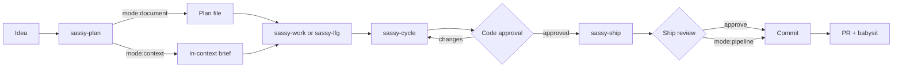
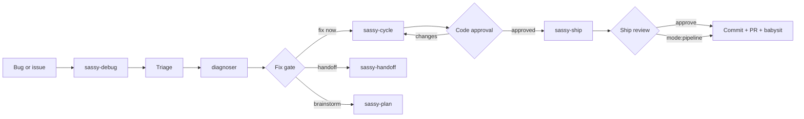

# Sassy Skills

**Lean and mean skills for shipping fast — with full control and 100% reliability.**

Sassy Skills is a suite of explicit-invocation Agent Skills for [pi](https://github.com/earendil-works/pi). It covers the whole path from a rough idea to a shipped PR, and from a bug report to a verified fix — without giving up human control at the moments that matter.

## Why this suite

- **Lean.** Skills are indexes and workflows, not documentation dumps. Detail moves into `references/` only when it is conditionally needed.
- **Explicit.** Every skill is invoked deliberately with `/skill:<name>`. No silent background behavior.
- **Controlled.** QA, code approval, and shipping review are separate, visible gates. They can be disabled deliberately when you want a pipeline run.
- **Reliable.** Work runs through `sassy-cycle` with isolated subagents for implementation, simplification, review, validation, and fixes.
- **Context-efficient.** Orchestrators coordinate; subagents do the heavy reading and return compact results.
- **Never surprising.** Nothing is committed just because a step finished. Shipping is its own phase.

## Quick start

```text
/skill:sassy-plan Add workspace invitations
/skill:sassy-work docs/plans/add-workspace-invitations.md
```

Or take the whole plan through one session:

```text
/skill:sassy-lfg docs/plans/add-workspace-invitations.md
```

For small work that does not need a plan document:

```text
/skill:sassy-plan mode:context Add a copy-link button to the invite modal
/skill:sassy-work mode:context
```

Debugging:

```text
/skill:sassy-debug https://github.com/org/repo/issues/123
```

## Skills

### Planning and execution

| Skill | What it does |
|---|---|
| **`sassy-plan`** | Brainstorms and scopes an idea. Writes a phased plan by default; `mode:context` keeps a single-phase brief in context. |
| **`sassy-work`** | Executes exactly one plan phase, or one in-context brief. |
| **`sassy-lfg`** | Executes an entire plan, or one in-context brief, then closes out. |
| **`sassy-cycle`** | Runs one unit of work through implement → simplify → review → validate → fix → re-check. |
| **`sassy-debug`** | Diagnoses a bug, gates the fix, fixes via `sassy-cycle`, then ships after code approval. |
| **`sassy-handoff`** | Summarizes the session and continues in a fresh session via `/handoff`. |

### Code quality

| Skill | What it does |
|---|---|
| **`sassy-review`** | Reviews a diff, branch, PR, or files, then offers to fix findings. |
| **`sassy-simplify`** | Finds and applies simplifications to recent changes without changing behavior. |
| **`sassy-validate`** | Checks whether work matches a plan or stated intent, then offers to close gaps. |

### Shipping

| Skill | What it does |
|---|---|
| **`sassy-ship`** | Compound learnings, optional handbook, commit, PR, and babysit. Review gate by default; `mode:pipeline` skips approvals. |
| **`sassy-commit`** | Creates a local commit with a clear message. No push, no PR. |
| **`sassy-commit-push-pr`** | Commits, pushes, opens or updates a PR, and babysits by default. |
| **`sassy-babysit`** | Watches a PR until it looks merge-ready or blocked. |

### Knowledge and docs

| Skill | What it does |
|---|---|
| **`sassy-compound`** | Records a solved problem as a durable repo learning. |
| **`sassy-handbook`** | Writes a plain-English team handbook with mermaid diagrams. |

### Meta

| Skill | What it does |
|---|---|
| **`sassy-skill`** | Creates, retunes, or restructures Agent Skills for pi. |

## Workflows

### From idea to ship



`mode:document` produces a durable plan with phased slices and optional manual QA. `mode:context` keeps the whole job as one in-context phase and writes no plan file.

`sassy-work` handles one phase and hands off the next. `sassy-lfg` drains the whole plan in one session. Both delegate to `sassy-cycle` and stop at the code approval gate unless `code-approval:off` is set.

`sassy-ship` is the close-out. In `mode:review` it summarizes what is about to ship and waits. `mode:pipeline` skips that gate and runs straight through.

### From bug to ship



`sassy-debug` reproduces and diagnoses through the read-only `diagnoser` subagent. It then stops at the fix gate with the causal chain, proposed fix, and risks.

At the fix gate you can:

- **fix now** — run the fix through `sassy-cycle`
- **handoff** — continue in a fresh session via `sassy-handoff`
- **brainstorm** — take the problem into `sassy-plan`

## Gates and controls

| Control | Default | Opt-out |
|---|---|---|
| Manual QA | `qa:manual` | `qa:off` |
| Code approval | `code-approval:manual` | `code-approval:off` |
| Ship review | `mode:review` | `mode:pipeline` |
| Plan document | `mode:document` | `mode:context` |

Gates are deliberate stops. Disabling one is an explicit choice, not an automatic shortcut.

## Repository layout

```text
sassy-skills/
├── skills/
│   ├── sassy-plan/
│   ├── sassy-work/
│   ├── sassy-lfg/
│   └── ...
├── scripts/
│   └── sync.sh
├── AGENTS.md
├── CONCEPTS.md
└── README.md
```

## Installation

This repo is designed to be the source of truth for user-level skills. The expected layout is a symlink:

```text
~/.agents/skills -> /path/to/sassy-skills/skills
```

Then invoke skills with `/skill:<name>` inside pi.

## Repository maintenance

`scripts/sync.sh` repairs the symlink, commits skill changes, rebases on `origin/main`, and pushes. Any agent that changes a skill must run it immediately, without asking for confirmation. `AGENTS.md` documents the workflow for agents working on this repo.
