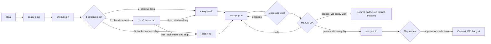
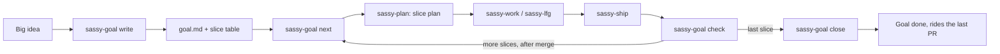
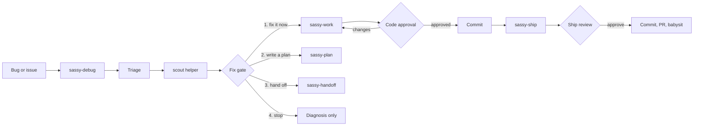

# Sassy Skills

**Lean and mean skills for shipping fast — with full control and 100% reliability.**

Sassy Skills is a suite of explicit-invocation Agent Skills. It follows the Agent Skills format, so it works with any harness that can load `SKILL.md` workflows. Where harnesses differ — how one skill loads another, how agents are dispatched, which command the user types — the skills follow one shared reference, `sassy-setup`'s `references/harness.md`, instead of assuming a harness. The subagents they dispatch come from [sassy-agents](https://github.com/sassywares/sassy-agents), one folder per harness.

It covers the whole path from a rough idea to a shipped PR, and from a bug report to a verified fix — without giving up human control at the moments that matter.

## Table of contents

- [Why this suite](#why-this-suite)
- [Quick start](#quick-start)
- [Skills](#skills)
- [Project config](#project-config)
  - [Dogfooding a project](#dogfooding-a-project)
  - [Working in parallel](#working-in-parallel)
  - [Extending the pipeline](#extending-the-pipeline)
- [Workflows](#workflows)
  - [From idea to ship](#from-idea-to-ship)
  - [From goal to done](#from-goal-to-done)
  - [From bug to ship](#from-bug-to-ship)
- [Gates and controls](#gates-and-controls)
- [Branching](#branching)
- [Installation](#installation)
  - [Per project](#per-project)
  - [Globally](#globally)
  - [Both at once](#both-at-once)
- [Repository maintenance](#repository-maintenance)

## Why this suite

- **Lean.** Skills are indexes and workflows, not documentation dumps. Detail moves into `references/` only when it is conditionally needed.
- **Explicit.** Every skill but `sassy-ship` runs only when you invoke it; ship may be started by the agent once you approve the work, and its review gate still waits. No silent background behavior.
- **Controlled.** Code approval, QA — manual and proved — and ship review are visible gates that all run in sequence. Mode tokens are opt-in per skill: `mode:manual` (default) and `mode:auto` on `sassy-ship` and `sassy-compound`, plus `mode:return` on `sassy-review`, `sassy-simplify`, and `sassy-validate`; work, lfg, and debug take no mode; `sassy-goal` takes one mode per step of a goal (`write`, `next`, `check`, `close`).
- **Reliable.** Work runs through `sassy-cycle` with isolated subagents for implementation, review, simplification, validation, and fixes — at the depth the change tier needs.
- **Context-efficient.** Orchestrators coordinate; subagents do the heavy reading and return compact results.
- **Never surprising.** Nothing is committed just because a step finished. Shipping is its own phase.

## Quick start

Examples use simple slash commands.

An optional first step: `/sassy-setup` detects the project and writes `.sassywares/config.yaml`, so plans, learnings, and PR bases land where your repo actually keeps them. Skipping it is fine — every key falls back to a documented default.

```text
/sassy-plan Add workspace invitations
```

That discussion settles the work, then offers a pick:

```text
Settled. Pick one:
1. Write the plan — docs/plans/<type>-<slug>.md
2. Start working via /sassy-work
3. Implement and ship it via /sassy-lfg
```

Pick 1 to get a plan file — YAML frontmatter (`type`, `created`, `updated`, plus `qa: off` when you ask for a plan with no QA gates) plus intent, decisions, and per-phase QA tables. Plan then asks again with just the other two — start working on it, or implement and ship it — or you stop there and run it later, one phase at a time:

```text
/sassy-work docs/plans/feat-add-workspace-invitations.md
```

Or the whole plan through one session:

```text
/sassy-lfg docs/plans/feat-add-workspace-invitations.md
```

For small work that does not need a plan document, choose 2 or 3 at the picker, or invoke the executor directly with the brief:

```text
/sassy-work "Add a copy-link button to the invite modal"
/sassy-lfg "Add a copy-link button to the invite modal"
```

Debugging:

```text
/sassy-debug https://github.com/org/repo/issues/123
```

## Skills

### Planning and execution

| Skill | What it does |
|---|---|
| **`sassy-plan`** | Grills you one question at a time through every branch of the work — pushing back, assuming nothing, sketching UI on request — until nothing is open, then offers three choices: write the plan, start working via `sassy-work`, or implement and ship via `sassy-lfg`. |
| **`sassy-goal`** | Runs a project too big for one plan — a migration, an epic — as a goal split into slices that each ship something complete. `mode:write` (default) grills and writes the goal, `mode:next` plans the next slice via `sassy-plan`, `mode:check` validates a shipped slice and carries its lessons forward, `mode:close` verifies the whole goal. You run every step. |
| **`sassy-scout`** | Grounds an area on demand and writes the shared grounding brief other agents read instead of re-exploring. |
| **`sassy-overview`** | Answers what a project is and how it runs — stack, runner, install, up, down, test, compose, env, wired — by inspecting files, read-only and with the source file for every value. `unknown` when the project hasn't said, and exit `3` so a caller branches instead of guessing. |
| **`sassy-work`** | Executes exactly one plan phase, or one in-context brief, commits after code approval, then stops — the next phase is a run you start. A brief stops before ship. |
| **`sassy-lfg`** | Executes every phase of a plan, or one in-context brief, then closes out via `sassy-ship` after code approval. |
| **`sassy-worktree`** | One checkout per branch, each with its own derived namespace, so two agents can work in one repo — taken when you ask, never because the config allows it. `create`, `list`, `remove`, `prune`: cut a checkout, see what exists, delete one, or clear the leftovers. |
| **`sassy-cycle`** | Runs one unit of work through a tiered loop: implement → simplify + review + validate for `logic`, review for `surface`, nothing for mechanical → one fix pass. No verify. Also reworks finished work from failed QA rows and picked findings. |
| **`sassy-debug`** | Diagnoses a bug, gates the fix, fixes via `sassy-work` (cycle, code approval, commit), then ships. Debug takes no mode and always leaves ship's review gate in place unless you invoke ship yourself with `mode:auto`. |
| **`sassy-handoff`** | `mode:write` (default) writes a self-contained handoff file to `/tmp/sassywares/handoffs/` and gives you a `sassy-handoff mode:read <path>` command for a fresh session; `mode:read` explains what the handoff did, why, and where things stand now, then asks what to do next. Works in any harness. |

### Code quality

| Skill | What it does |
|---|---|
| **`sassy-review`** | Reviews a diff, branch, PR, or files for bugs, security, project-rule conformance, and design-system conformance, then fixes the findings you pick. |
| **`sassy-simplify`** | Finds behavior-preserving simplifications — reuse, quality, efficiency — then applies the ones you pick. |
| **`sassy-validate`** | Checks whether work matches a plan or stated intent, then closes the gaps you pick. |
| **`sassy-dogfood`** | Uses the product the way a user does to prove a change actually works at runtime — runs the project's stored procedure, writes a report with a verdict, and in `mode:discover` builds or repairs that procedure from what really worked. Tooling-agnostic: it uses whatever your harness has connected and never installs a runner. |

Each does one job and takes `mode:manual` (default: ask which to fix), `mode:auto` (fix without asking), or `mode:return` (report only). Fixes run through `sassy-cycle` as one work pass. Inside work, lfg, and debug, the cycle runs the agents its change tier needs.

`sassy-dogfood` takes its own modes instead: `run` (default), `discover`, and `check`.

### Shipping

| Skill | What it does |
|---|---|
| **`sassy-ship`** | Compound learnings, optional handbook, commit, PR, and babysit (under `commit.branch: current`: commit and push, no PR). Review gate in `mode:manual` (default), skipped by `mode:auto`. |
| **`sassy-commit`** | Creates a local commit with a clear message. No push, no PR. |
| **`sassy-commit-push-pr`** | Commits, pushes, opens or updates a PR, and babysits by default. |
| **`sassy-babysit`** | Watches a PR until it looks merge-ready or blocked. |

### Knowledge and docs

| Skill | What it does |
|---|---|
| **`sassy-compound`** | Records a solved problem as a durable repo learning. Takes `mode:manual` or `mode:auto`; ship passes `mode:auto` after its own gate. |
| **`sassy-handbook`** | Writes a plain-English team handbook with mermaid diagrams. |

### Meta

| Skill | What it does |
|---|---|
| **`sassy-skill`** | Creates, retunes, or restructures Agent Skills. |
| **`sassy-setup`** | Detects the project topology and writes `.sassywares/config.yaml`; installs the suite and the sassy-agents subagents, globally or per project, when missing; installs the snapshot tooling for a multi-repo workspace; commits the files it wrote. `mode:check` verifies an existing setup, including a project install's pin. |

## Project config

Every skill resolves one file, `.sassywares/config.yaml`, found by walking up from where you are. It is optional — no file means the documented defaults.

```yaml
artifacts:                       # where plans, learnings, handbooks, and the glossary live
  plans: docs/plans
  solutions: docs/solutions
  handbooks: docs/handbooks
  concepts: CONCEPTS.md
knowledge:
  read: [docs/solutions, CONCEPTS.md]   # searched for prior learnings
  write: true                           # false = this project takes no learnings
git:
  repo: origin                   # a remote name | workspace (repos below, none here) | none (no git)
  base_map:                      # head branch -> the base it targets
    "*": staging                 # ordinary work branches from and targets staging
    staging: main                # staging releases to main
  # remote: owner/backup         # workspace only: the snapshot mirror
  # mirror_branch: main          # workspace only: the mirror's branch
repos:                           # workspace only: each nested repo -> the base its PRs target
  fe: dev
commit:
  branch: current
pr:
  babysit: true
  merge: false                   # true authorizes merging every babysat PR here
  delete_branch: false
hooks:
  pr:
    "*":                         # keyed by the PR's HEAD branch
      before_create: [tap2-version mode:auto]   # after the commit, before the PR opens
      after_create: []           # the moment the PR exists
      before_merge: []           # this run is about to merge
      after_merge: []            # this run observed the merge
    staging:                     # a per-point override for one head
      before_create: []
  goal:                          # keyed by the goal slug, not a branch
    "*":
      before_slice: []           # sassy-goal next: after the previous slice merges
      after_close: []            # sassy-goal close: after the status is persisted
  push:                          # only under commit.branch: current
    "*":
      after_push: []             # right after the push succeeds
  # worktree:                    # worktrees only; keyed by the checkout's branch
  #   "*":
  #     after_create: []          # derive .env, seed, copy the session in
  #     before_remove: []         # drop the database, shut the device
worktrees:                       # parallel checkouts of this repo
  enabled: false                 # true = a run may offer its own checkout
  dir: ~/.sassywares/worktrees   # parent of the per-repo folder
# up:/down: are top level — not under worktrees: — each `<script> <args…>` or `<skill> <args…>`
# up: ./bin/up
# down: ./bin/down             # absent = no lifecycle
dogfood:                         # agent QA: a stored procedure that proves a change runs
  enabled: false                 # true lets a plan write Mode: Auto QA rows
  recipe: .sassywares/dogfood/recipe.md      # the procedure; never commands here
  reports: .sassywares/dogfood/reports       # run output; gitignored
  timeout: 900                   # whole procedure, seconds
```

### Working in parallel

Two agents in one repo need two checkouts, and a checkout needs a name — a
directory, a namespace, a database. `worktrees:` turns that on:

```text
~/.sassywares/worktrees/shop/
├── .repo        which checkout owns this folder
└── feat-catalog-search/
```

Only checkouts this tooling manages are listed or pruned: one under `worktrees.dir`
that also carries `.sassywares/config.yaml`. Anything else — another tool's
worktree, or one cut from a ref that predates the wiring — is counted in a footer
and left alone.

`enabled: true` makes a checkout **available**, never default: a run asks before it
takes one and otherwise works in the main checkout, because two runs only collide
when they are actually parallel. `sassy-worktree create` takes one whenever you
ask for it, and a run carrying `worktree:on` has already been told yes.

Setup installs the tooling as four scripts in `.sassywares/worktree/` — `create`,
`list`, `remove`, `prune` — run by path, `.sassywares/worktree/create
feat/catalog`. No command runner is required: if the project already has one that
carries named commands, setup offers to wire `worktree:<script>` aliases into it,
and never creates a manifest to hold them, so a Go, Python, or Dart project keeps
its own tooling file and nothing else.

`create` derives the identity from the branch and prints it — `WT_PATH`,
`WT_BRANCH`, `WT_SLUG`, `WT_NAMESPACE` — so a project's hook derives `.env`, a
database name, or a simulator from one source instead of inventing its own.

A checkout's branch is cut **untracked**, and `create` prints the upstream it
found — `none` on a fresh branch, and a plain-English warning when an existing
branch tracks something other than its own name. Cut from `origin/staging`, git's
DWIM would have made `staging` that branch's upstream, so the branch's own `git
push` would aim at the base: a run that looks healthy until it ships.

**A checkout's address and its stack are the project's own business.** The suite
derives no address and runs no app: how a checkout is looked at, and what command
brings it up, are the top-level `up:` and `down:` keys — each one line, a script
or a skill and its args. Two checkouts running the same app collide on the same
fixed port unless the project's `up:` keeps them apart, so a project that needs a
per-checkout value derives it there from `$WT_SLUG`. Nothing here claims or tracks
one, and a collision surfaces in the project's own command.

It needs `commit.branch: new`: under `current` a run commits where it stands and
never cuts a branch, so nothing would create a checkout. `--check` says so rather
than leaving a switch that cannot fire.

`up:` runs in the foreground and is stopped with SIGTERM, so it must reap its
children; `down:` terminates what `up:` started and exits. `remove` runs `down:`
when the project declares one, then deletes the checkout. A worktree gets a fresh,
empty `.sassywares/session/`, and most providers register one callback URL, so the
usual answer is to copy or link the main checkout's session in the `after_create`
hook: a cookie is host-scoped, while a `localStorage` session is origin-scoped and
has to be injected per origin.

Nothing here keeps state: `list` reports branch, path, dirty, and upstream, and
`remove` refuses a dirty tree, unpushed commits, or the main checkout.

### Extending the pipeline

A project adds its own steps by naming a skill that lives in its own `.agents/skills/`. Nothing declared means nothing runs. Keys are the **head** branch — the one a PR comes from (for `hooks.push`, the pushed branch) — and every point can be overridden per head, except `hooks.goal`, which is keyed by the goal slug, the goal's folder under `artifacts.plans`; entries may carry args (`<skill> <args…>`).

| Hook | Runs | Typical use |
|---|---|---|
| `before_create` | after the commit, before the PR opens | release artifacts: changeset, release notes, i18n sync |
| `after_create` | the PR was just created | labels, deploy-target comment |
| `before_merge` | this run is about to merge | a final approval gate |
| `after_merge` | this run observed the merge | sync a back-merge branch, tag, notify |
| `hooks.push` `after_push` | `commit.branch: current` only: after ship's push | notify, trigger a follow-up step |
| `hooks.worktree` `after_create` | just after a checkout exists | derive `.env`, seed the database, copy the session in |
| `hooks.worktree` `before_remove` | before the checkout is deleted | drop the derived database, shut the simulator |
| `hooks.goal` `before_slice` | `sassy-goal mode:next`: after the previous slice's merge is confirmed, before the slice is grilled | switch to the bases, pull, migrate, seed |
| `hooks.goal` `after_close` | `sassy-goal mode:close`: after the goal's status is persisted | post the goal summary, notify, tear down per-slice environments |

Hooks run in declared order, one subagent each, and fail closed: a declared skill that is missing or returns `blocked` stops the run. Which points may write, and how, is stated once in `sassy-setup`'s `references/config.md` (the hook contract). `before_merge` and `after_merge` never fire unless this run merges. Goal hooks may do anything except touch the goal itself, as long as every base ends level with its remote; `before_slice` fires before `mode:next` checks the base, and neither is suppressed by `commit.branch: current`.

This is deliberately not a fork mechanism. A project skill that *adds* a step is a hook; one that *restates* our steps is a copy, and copies rot. Rules are not hooks either — those belong in `AGENTS.md`.

### Dogfooding a project

Agent QA is opt-in and stores a **procedure**, not a command. One command can never say "seed first, boot the simulator, wait for the health endpoint, then re-auth if the token is stale" — and that ordering is the only genuinely project-specific part. So the config holds four keys and the work lives in a file:

```text
.sassywares/
├── config.yaml
└── dogfood/
    ├── recipe.md      committed — ordered steps, one `Prove it:` step per section
    ├── .gitignore     one line: /reports/
    └── reports/       run logs and artifacts — never committed
```

`recipe.md` is the project's, written by `sassy-dogfood mode:discover` from what actually worked, and reviewed like code: numbered steps you append to, each with a `Do` and an `Expect`, ending in a `Prove it:` step whose exit code is the verdict. It names no tool, so it outlives whichever browser driver or emulator your harness happens to have this quarter.

A QA row is `Auto` only when `dogfood.enabled` is `true` **and** the row names a recipe section with a `Prove it:` step. One without the other keeps the row `Manual`, which is how an unfinished recipe degrades safely instead of turning into a gate that proves nothing. Anything subjective, physical, irreversible, or unobservable stays a human's check — a false `Auto` pass is unrecoverable. The directory also makes a good fence: a run that trips on a step may not edit the recipe to pass, only propose the diff.

Precedence is always explicit token > session instruction > config > skill default. `sassy-setup` writes the file from the tree it detects and keeps `pr.merge` off unless you say otherwise. The full schema, resolution chains, and the three topologies are in [`skills/sassy-setup/references/config.md`](skills/sassy-setup/references/config.md).

In a `workspace` there is exactly one ignore file, and it is not at the root:

```text
.sassywares/
├── config.yaml
└── workspace/
    ├── snapshot      installed by sassy-setup
    ├── .gitignore    what the snapshot leaves out
    └── mirror/       the side clone, excluded by the script itself
```

## Workflows

### From idea to ship



Option 1 produces a durable plan with phased slices, QA tables, and a change tier per phase. Options 2 and 3 keep the whole job as one settled in-context brief and write no plan file.

`sassy-work` handles one phase and stops after its commit. `sassy-lfg` drains the whole plan in one session. Both delegate to `sassy-cycle` and stop at one gate carrying code approval plus the QA checklist; nothing is `Done`, committed, or shipped until both pass. `Manual` rows are yours to run. `Auto` rows are proved before the gate by `sassy-dogfood`, and a failed one goes back through the cycle as a finding. With an in-context brief there are no QA rows, so the gate is code approval alone.

Inside the cycle, the **change tier** decides the depth: a `logic` change runs the simplifier, reviewer, and validator in parallel; a `surface` change — docs, copy, tests, fixtures — runs the reviewer; a mechanical change skips review. Every finding is then fixed in one work pass — criticals, warnings, validator gaps, and simplifications together — and the cycle does not re-review the fix. Findings the worker leaves open are reported at the gate, simplifications never block, and the reviewer's suggestions are listed for you to pick. A change you request at the gate is new work: a fresh cycle at its detected tier, so it gets the review its change deserves, then the gate comes back. QA rows that fail on their own are the one-pass rework.

The branch is cut once, before the first change, by `sassy-work` or `sassy-lfg` — never at commit time — and `sassy-ship` never creates it. `commit.branch` (default `new`) decides whether the run cuts one at all; see [Branching](#branching).

`sassy-ship` is the close-out. It summarizes what is about to ship and waits, unless the caller passed `mode:auto`.

### From goal to done



A goal is a folder under `artifacts.plans` — `<type>-<slug>/` — holding `goal.md` and one plan per started slice (`01-<slice>.md`, `02-…`). `mode:write` grounds every affected domain once, grills only goal-level branches — slice boundaries and order, coexistence, the goal's done-when, non-goals — and pushes back on any slice that would leave a half-built layer. Each slice's plan is grilled only when `mode:next` starts it, with the goal's decisions and every carry-forward entry already settled; before that grill, and once the previous slice's merge is confirmed, `mode:next` runs the project's `before_slice` steps. The slice then runs the usual work or lfg → ship path on its own branch (`feat/<goal>/<NN-slice>`, with `<goal>` the goal folder minus its `<type>-` prefix — `feat-offline-reads/` → `feat/offline-reads/02-cached-list`); ship marks it `Shipped` and babysits the PR without merging, so the check can still land in it.

`mode:check` runs on the slice branch before the PR merges: it validates the whole slice plan against the branch's commits, and every gap is fixed now, deferred to a named later slice, or accepted with a reason. It appends the slice's carry-forward entry, marks it `Done` with its PR link, and pushes `goal.md` into the same PR. After the last slice, `mode:close` checks the goal's done-when against the whole tree and marks the goal `done` in the last PR, then runs the project's `after_close` steps once the status is persisted. One slice is in flight at a time, and nothing chains on its own.

### From bug to ship



`sassy-debug` diagnoses inline, using the read-only `scout` as a helper to ground the failure surface; the causal reasoning stays in the main context. It then stops at the fix gate with the causal chain, proposed fix, and risks.

The fix gate offers four options:

- **Fix it now** — hand the fix brief to `sassy-work`: one cycle, the code approval gate, a commit; then debug ships it via `sassy-ship`
- **Write a plan** — carry the diagnosis into `sassy-plan`, which ends in its own 3-option picker
- **Hand off** — continue in a fresh session via `sassy-handoff`
- **Stop here** — keep the diagnosis and change nothing

`sassy-debug` takes no mode. Shipping keeps its own `mode:manual` gate unless you invoke `sassy-ship` yourself with `mode:auto`.

## Gates and controls

| Control | When it applies |
|---|---|
| Code approval | Always on for `sassy-work` and `sassy-lfg`. |
| Review tier | Per plan phase (`**Review:**`) or a `review:` token, else detected by the cycle. `logic` runs simplify + review + validate; `surface` runs review; `none` skips review. The cycle fixes once and never re-reviews. |
| Gate changes | A change you request while the gate is open is new work: a fresh cycle at its detected tier, then the gate again. Failing QA rows alone are a one-pass rework. |
| QA | Part of the same gate, and only when the plan document has QA tables. `Manual` rows are yours; `Auto` rows are settled by a `sassy-dogfood` report. A phase is `Done` only when both pass. |
| Dogfood | `Auto` rows only exist when `dogfood.enabled` is on and the row's recipe section has a `Prove it:` step. `sassy-ship` persists nothing behind an unproven row. |
| Ship review | On in `mode:manual` (default), skipped by `mode:auto`. |

The artifact decides QA: a plan document carries QA tables that gate phase completion unless its frontmatter sets `qa: off`; an in-context brief has no QA tables at all. Gates are deliberate stops; the only way past one is the user's approval. `mode:auto` is accepted only by `sassy-ship` and `sassy-compound`.

## Branching

`sassy-work`, `sassy-lfg`, and `sassy-debug` decide the branch **before they touch code**, from `commit.branch` (default `new`) compared against `base_map`. On `new`, the run cuts a branch and every commit — phases, docs, ship — lands on it, so no change ever exists on a base branch. A run that is already on a branch that is not a base reuses it, which is how a resumed run, a second `sassy-work` for the next phase, or `sassy-lfg` after `sassy-work` converges instead of cutting a second branch.

With `worktrees.enabled`, a run **offers** a worktree when it cuts a branch and
takes one only if you say yes: the branch and its checkout appear together, the
rest of the run works in `WT_PATH`, and the main checkout stays read-only. Say no
and the branch is cut in place, as usual. A run that finds itself on a non-base
branch reuses it, which is what keeps a resumed run inside the worktree the first
one took. Say yes up front instead with `worktree:on` — no offer, and a managed
checkout that already exists for the branch is reused — or stop the offer with
`worktree:off`. `worktree:on` fails closed when `worktrees.enabled` is off, in a
workspace or a folder with no git, or under `commit.branch: current`.

A base is **any `base_map` value**, not just the remote default: in a repo whose `"*"` targets `staging`, standing on `staging` counts as standing on a base. That distinction is the whole point of the key — see [`skills/sassy-setup/references/branching.md`](skills/sassy-setup/references/branching.md).

The three skills take `branch:infer|current|new` to override the config's branching for one run (the no-PR close-out follows the config `commit.branch: current` regardless of the token): `infer` (default) means the config decides, `new` forces a branch, `current` commits where you stand; it does not skip the PR. They also take `worktree:on|off` to answer the checkout question before it is asked: `on` takes a checkout without asking, `off` cuts the branch in place even with `worktrees.enabled`, and both are no-ops on a reused branch, so a second run never cuts a second checkout. Only `commit.branch: current` in the config makes the close-out push to the upstream with no PR, hooks, or babysit. `sassy-ship` never creates a branch; finding the head on a base branch with unpublished commits is a stop-and-ask, except under `commit.branch: current`, where they are pushed along.

## Installation

The suite installs from this repository with the open `skills` CLI. Install it per project, globally, or both.

### Per project

The team's setup. The CLI vendors the skill files into the project and pins them, so a clone needs no network and every checkout runs the same skills.

```bash
npx skills add sassywares/sassy-skills
```

That writes three things:

- `.agents/skills/sassy-*` — the skill files themselves, read by pi and Cursor
- `.claude/skills/sassy-*` — links for Claude Code, which reads only its own directory
- `skills-lock.json` — source and content hash per skill

Commit the vendored skills and the lock; ignore `.claude/skills`, which is a link created at install time.

```bash
npx skills update -p -y           # pull the latest from this repo
npx skills experimental_install   # restore exactly what the lock pins
npx skills remove --all           # take the suite out again
```

`npx skills check` is an alias for `update`: it moves the pin, it does not validate it. To check a project's setup without touching the pin, run `sassy-setup` with `mode:check`.

### Globally

Your own setup, in every project on this machine, with nothing committed anywhere.

```bash
npx skills add sassywares/sassy-skills -g
```

That writes:

- `~/.agents/skills/sassy-*` — the skill files, read by pi and other harnesses that use `~/.agents/skills`
- `~/.claude/skills/sassy-*` — links for Claude Code
- `~/.agents/.skill-lock.json` — the global lock

```bash
npx skills update -g -y           # pull the latest from this repo
npx skills remove -g --all        # take the suite out again
```

A global install is yours alone: teammates do not get it, and it moves whenever you update rather than with the project.

### Both at once

A skill installed in both places is listed once, not twice; the harness picks one copy. Claude Code prefers the global copy over the project's, so on a machine with a global install the project's pin does not decide which version Claude Code runs. Other harnesses apply their own precedence. When a project's pinned version must be the one that runs, skip the global install on that machine.

`sassy-setup` handles either scope, the same way it handles the agents: if the suite is already installed it reports where, and if not it asks where to install it, recommending global. A project install also gets the ignore line, the verified pin, and the commit. `mode:check` verifies the pin only for a project install; a global one has nothing to pin.

### While editing the suite

`.pi/settings.json` in this repo declares `./skills`, so pi loads your working copy directly. Consumers see a change once it is pushed to `main` and they run `npx skills update` — no release step in between.

### Also published as a package

`@sassywares/skills` is on npm for harnesses that install packages rather than skill directories:

```bash
pi install npm:@sassywares/skills
```

## Repository maintenance

Work here lands on `main` through `sassy-ship` (`commit.branch: current`). After the approved push, the project's `hooks.push` `after_push` step runs the release: on `main`, when files consumers receive changed, it bumps the patch version and tags it, and the tag publishes `@sassywares/skills` to npm. [`AGENTS.md`](AGENTS.md) is the full guide: layout, adding a skill, testing, and releasing.
