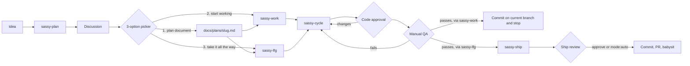
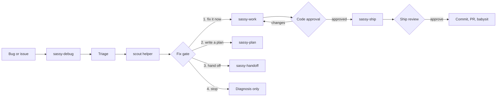

# Sassy Skills

**Lean and mean skills for shipping fast — with full control and 100% reliability.**

Sassy Skills is a suite of explicit-invocation Agent Skills. It follows the Agent Skills format, so it works with any harness that can load `SKILL.md` workflows.

It covers the whole path from a rough idea to a shipped PR, and from a bug report to a verified fix — without giving up human control at the moments that matter.

## Table of contents

- [Why this suite](#why-this-suite)
- [Quick start](#quick-start)
- [Skills](#skills)
- [Workflows](#workflows)
  - [From idea to ship](#from-idea-to-ship)
  - [From bug to ship](#from-bug-to-ship)
- [Gates and controls](#gates-and-controls)
- [Repository layout](#repository-layout)
- [Installation](#installation)
- [Repository maintenance](#repository-maintenance)

## Why this suite

- **Lean.** Skills are indexes and workflows, not documentation dumps. Detail moves into `references/` only when it is conditionally needed.
- **Explicit.** Every skill is invoked deliberately. No silent background behavior.
- **Controlled.** Code approval, manual QA, and ship review are visible gates that all run in sequence. There are two mode tokens, `mode:manual` (default) and `mode:auto`, accepted by `sassy-ship` and `sassy-compound` only; every other skill takes no mode.
- **Reliable.** Work runs through `sassy-cycle` with isolated subagents for implementation, review, validation, and fixes.
- **Context-efficient.** Orchestrators coordinate; subagents do the heavy reading and return compact results.
- **Never surprising.** Nothing is committed just because a step finished. Shipping is its own phase.

## Quick start

Examples use simple slash commands.

```text
/sassy-plan Add workspace invitations
```

That discussion settles the work, then offers a pick:

```text
Settled. Pick one:
1. Write it to docs/plans/<slug>.md
2. Start working now — stop before ship
3. Take it all the way — run it, ship it, babysit the PR
```

Pick 1 to get a plan file, then run one phase at a time:

```text
/sassy-work docs/plans/add-workspace-invitations.md
```

Or take the whole plan through one session:

```text
/sassy-lfg docs/plans/add-workspace-invitations.md
```

For small work that does not need a plan document, choose 2 or 3 at the picker, or invoke the executor directly with the brief:

```text
/sassy-work "Add a copy-link button to the invite modal"
/sassy-lfg "Add a copy-link button to the invite modal"
```

Debugging:

```text
/sassy-debug https://github.com/org/repo/issues/123
```

## Skills

### Planning and execution

| Skill | What it does |
|---|---|
| **`sassy-plan`** | Brainstorms and settles the work in one discussion, then offers three choices: write the plan, start working now, or take it all the way to a PR. |
| **`sassy-scout`** | Grounds an area on demand and writes the shared grounding brief other agents read instead of re-exploring. |
| **`sassy-work`** | Executes exactly one plan phase, or one in-context brief, commits after code approval, then hands off the next phase — a brief stops before ship. |
| **`sassy-lfg`** | Executes every phase of a plan, or one in-context brief, then closes out via `sassy-ship` after code approval. |
| **`sassy-cycle`** | Runs one unit of work through implement → review → validate → fix → re-check. |
| **`sassy-debug`** | Diagnoses a bug, gates the fix, fixes via `sassy-cycle`, then ships after code approval. Debug takes no mode and always leaves ship's review gate in place unless you invoke ship yourself with `mode:auto`. |
| **`sassy-handoff`** | Summarizes the session and opens a fresh one via `/handoff`, with the continuation prompt seeded in the editor for you to submit. |

### Code quality

| Skill | What it does |
|---|---|
| **`sassy-review`** | Reviews a diff, branch, PR, or files for bugs, project-rule conformance, and design-system conformance, then offers to fix findings. |
| **`sassy-validate`** | Checks whether work matches a plan or stated intent, then offers to close gaps. |

### Shipping

| Skill | What it does |
|---|---|
| **`sassy-ship`** | Compound learnings, optional handbook, commit, PR, and babysit. Review gate in `mode:manual` (default), skipped by `mode:auto`. |
| **`sassy-commit`** | Creates a local commit with a clear message. No push, no PR. |
| **`sassy-commit-push-pr`** | Commits, pushes, opens or updates a PR, and babysits by default. |
| **`sassy-babysit`** | Watches a PR until it looks merge-ready or blocked. |

### Knowledge and docs

| Skill | What it does |
|---|---|
| **`sassy-compound`** | Records a solved problem as a durable repo learning. Takes `mode:manual` or `mode:auto`; ship passes `mode:auto` after its own gate. |
| **`sassy-handbook`** | Writes a plain-English team handbook with mermaid diagrams. |

### Meta

| Skill | What it does |
|---|---|
| **`sassy-skill`** | Creates, retunes, or restructures Agent Skills. |
| **`sassy-compare`** | Runs one prompt against two models in isolated worktrees and compares output, code changes, timing, tokens, and errors. |

## Workflows

### From idea to ship



Option 1 produces a durable plan with phased slices and manual QA tables. Options 2 and 3 keep the whole job as one settled in-context brief and write no plan file.

`sassy-work` handles one phase and hands off the next. `sassy-lfg` drains the whole plan in one session. Both delegate to `sassy-cycle` and stop at one gate carrying code approval plus the manual QA checklist; nothing is `Done`, committed, or shipped until both pass. With an in-context brief there are no QA rows, so the gate is code approval alone.

Work always commits to the current branch; `sassy-ship` creates the shipping branch at close-out when the checked-out branch is the repo default.

`sassy-ship` is the close-out. It summarizes what is about to ship and waits, unless the caller passed `mode:auto`.

### From bug to ship



`sassy-debug` diagnoses inline, using the read-only `scout` as a helper to ground the failure surface; the causal reasoning stays in the main context. It then stops at the fix gate with the causal chain, proposed fix, and risks.

The fix gate offers four options:

- **Fix it now** — hand the fix brief to `sassy-work`: one cycle, its own code approval gate, a commit, then a stop before ship
- **Write a plan** — carry the diagnosis into `sassy-plan`, which ends in its own 3-option picker
- **Hand off** — continue in a fresh session via `sassy-handoff`
- **Stop here** — keep the diagnosis and change nothing

`sassy-debug` takes no mode. Shipping keeps its own `mode:manual` gate unless you invoke `sassy-ship` yourself with `mode:auto`.

## Gates and controls

| Control | When it applies |
|---|---|
| Code approval | Always on for `sassy-work` and `sassy-lfg`. |
| Manual QA | Part of the same gate, and only when the plan document has QA tables. The user runs the rows; a phase is `Done` only when both pass. |
| Ship review | On in `mode:manual` (default), skipped by `mode:auto`. |

The artifact decides QA: a plan document carries manual QA tables that gate phase completion, an in-context brief does not. Gates are deliberate stops; the only way past one is the user's approval. `mode:auto` is accepted only by `sassy-ship` and `sassy-compound`.

## Repository layout

```text
sassy-skills/
├── skills/
│   ├── sassy-plan/
│   ├── sassy-work/
│   ├── sassy-lfg/
│   └── ...
├── scripts/
│   └── sync.sh
├── AGENTS.md
├── CONCEPTS.md
└── README.md
```

## Installation

Sassy Skills are plain Agent Skills. Clone the repo, then symlink the whole suite or copy only the skills you want.

### Clone

```bash
git clone https://github.com/sassywares/sassy-skills.git ~/sassy-skills
```

### Option A — symlink the whole suite

```bash
ln -s ~/sassy-skills/skills ~/.agents/skills
```

Replace `~/.agents/skills` with your harness's skills directory if it uses a different path.

### Option B — symlink individual skills

```bash
mkdir -p /path/to/your/skills
ln -s ~/sassy-skills/skills/sassy-plan /path/to/your/skills/sassy-plan
ln -s ~/sassy-skills/skills/sassy-work /path/to/your/skills/sassy-work
```

### Option C — copy individual skills

```bash
mkdir -p /path/to/your/skills
cp -R ~/sassy-skills/skills/sassy-plan /path/to/your/skills/
```

Use this when you only want a few workflows and do not want to track the repo.

Invoke the skills using your harness's skill syntax.

## Repository maintenance

`scripts/sync.sh` repairs the symlink, commits skill changes, rebases on `origin/main`, and pushes. Any agent that changes a skill must run it immediately, without asking for confirmation. `AGENTS.md` documents the workflow for agents working on this repo.
